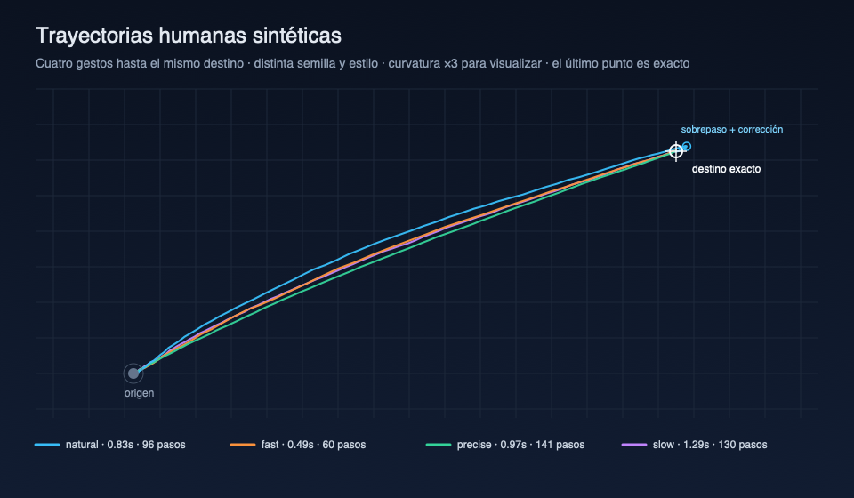

# mcp-human-mouse

Servidor **MCP** (Model Context Protocol) que permite a un agente leer la posición del ratón y moverlo, hacer clic, arrastrar y desplazar la rueda con trayectorias que imitan el movimiento de una persona.

No hace saltos instantáneos ni líneas rectas a velocidad constante: genera curvas con aceleración y frenada suaves, temblor de baja amplitud, sobrepaso y corrección final, pausas de reacción y tiempos de presión variables.

```
move_human(x=1200, y=700, style="natural")
```



## Herramientas

| Herramienta | Qué hace |
|---|---|
| `mouse_state` | Posición actual, botones pulsados, área de pantalla y monitores. |
| `move_human` | Mueve el cursor a `(x, y)` con una trayectoria humana. |
| `click_human` | Clic, doble clic o triple clic, con aproximación humana y timing realista. |
| `drag_human` | Arrastra manteniendo pulsado el botón; suelta siempre, incluso si se cancela. |
| `scroll_human` | Rueda en bloques irregulares de 1-5 líneas con pausas. |
| `capture_trace` | Graba posición y botones durante N segundos y devuelve muestras y estadísticas. |
| `request_permission` | Pide permiso de Accesibilidad al sistema (macOS). |
| `stop_motion` | Cancela el movimiento en curso en el siguiente paso. |
| `diagnostics` | Backend, pantallas, posición, permiso y límites. Llámala primero. |

### Estilos

| Estilo | Uso | Rasgos |
|---|---|---|
| `natural` | Por defecto | ~0,2-1,5 s según distancia, temblor normal, sobrepaso frecuente. |
| `fast` | Movimientos rápidos | Más corto, algo más de sobrepaso y temblor. |
| `precise` | Objetivos pequeños | Más lento, poco temblor, sin sobrepaso. |
| `slow` | Demostraciones | El más lento y pausado. |

### Parámetros útiles

- `duration_s`: fija la duración; si se omite se calcula con la ley de Fitts.
- `jitter`: multiplicador del temblor (`0` = sin temblor).
- `curvature`: multiplicador de la curvatura (`0` = recto).
- `overshoot`: `true` fuerza sobrepaso, `false` lo desactiva, `null` decide solo.
- `clamp`: si el destino está fuera de pantalla, lo ajusta al borde en vez de fallar.
- `dry_run`: simula y devuelve la trayectoria sin publicar eventos.

## Instalación

Requisitos: Python 3.10-3.12 y, en macOS, permiso de Accesibilidad.

```bash
git clone https://github.com/cobraneeo/mcp-human-mouse.git
cd mcp-human-mouse
uv sync --python 3.12
```

Sin `uv`:

```bash
python3.12 -m venv .venv
.venv/bin/pip install -e .
```

Prueba que arranca:

```bash
.venv/bin/python scripts/smoke_test.py
```

## Configuración MCP

### Cliente genérico (Claude Desktop, Cursor, etc.)

Sustituye `/ABS/mcp-human-mouse` por la ruta real:

```json
{
  "mcpServers": {
    "human-mouse": {
      "command": "/ABS/mcp-human-mouse/.venv/bin/python",
      "args": ["/ABS/mcp-human-mouse/server.py"]
    }
  }
}
```

En Claude Desktop para macOS el archivo es
`~/Library/Application Support/Claude/claude_desktop_config.json`.

### DeepSeek Harness

Añade esta entrada a `cordis.patch.yml` del perfil activo:

```yaml
- id: mcp-manager
  config:
    servers:
      human-mouse:
        transport: stdio
        command: /ABS/mcp-human-mouse/.venv/bin/python
        args: ["/ABS/mcp-human-mouse/server.py"]
        enabled: true
        startupTimeoutMs: 30000
```

El archivo del perfil `desktop` está en:

```
~/Library/Application Support/IDE .NET/harness-home/profiles/desktop/cordis.patch.yml
```

> El parche del perfil **reemplaza el mapa `servers` completo**. Si ya tienes
> otros servidores MCP configurados ahí, añádelos junto a `human-mouse`.

Reinicia DeepSeek Harness (o recarga el perfil) y comprueba que aparecen las
herramientas `mcp__human-mouse__*`.

## Permisos en macOS

Leer la posición no requiere permiso. **Publicar eventos de ratón sí**: sin
Accesibilidad, el servidor puede calcular la trayectoria pero el cursor no se
mueve.

1. Llama a `diagnostics` y mira `accessibility.trusted`.
2. Si es `false`, llama a `request_permission` para que aparezca el diálogo; si
   no aparece, abre **Ajustes del Sistema → Privacidad y seguridad →
   Accesibilidad**.
3. Activa la aplicación que lanza el servidor MCP:
   - DeepSeek Harness: **IDE .NET**.
   - Claude Desktop: **Claude**.
   - Uso manual: **Terminal** (o iTerm).
4. Reinicia esa aplicación (y el servidor MCP).

El proceso hijo hereda el permiso del proceso responsable, así que hay que
activar la app host, no el binario de Python.

En Windows no hace falta permiso especial; en Linux se necesita una sesión
X11 o XWayland.

## Ejemplos de uso

```text
Llama a diagnostics y dime si puedes mover el ratón.

Mueve el cursor al botón de guardar (742, 512) con estilo precise y luego
haz clic.

Haz doble clic en (320, 240) con el botón izquierdo.

Arrastra desde (400, 300) hasta (900, 650) en 1,2 segundos.

Baja 12 líneas con la rueda sobre el centro de la ventana.

Graba 3 segundos de mi movimiento del ratón y dime la velocidad máxima.

Simula un movimiento a (1400, 800) sin moverlo (dry_run) y enséñame la
duración y los pasos.
```

## Variables de entorno

| Variable | Por defecto | Efecto |
|---|---|---|
| `HUMAN_MOUSE_DRY_RUN` | `0` | `1` hace que todas las herramientas simulen. |
| `HUMAN_MOUSE_SPEED` | `1.0` | `>1` más lento, `<1` más rápido. |
| `HUMAN_MOUSE_SEED` | aleatorio | Fija la semilla para trayectorias reproducibles. |
| `HUMAN_MOUSE_MAX_DURATION` | `30` | Límite de duración en segundos. |
| `HUMAN_MOUSE_ALLOW_UNTRUSTED` | `0` | `1` permite publicar aunque el SO diga que no hay permiso (útil para diagnosticar). |

## Cómo se genera el movimiento

1. **Duración**: ley de Fitts (`0,12 + 0,11·log2(D/8+1)`), con variación
   aleatoria y multiplicador de estilo.
2. **Curva**: Bézier cúbica con desplazamiento perpendicular aleatorio; la
   trayectoria se curva ligeramente, nunca es una recta perfecta.
3. **Velocidad**: perfil de mínima sacudida `10t³ − 15t⁴ + 6t⁵`, que arranca y
   frena con aceleración continua.
4. **Temblor**: proceso de Ornstein-Uhlenbeck (ruido correlacionado, no blanco)
   más un tremor senoidal de 7,5-11,5 Hz y 0,3 px.
5. **Sobrepaso**: en distancias largas apunta 3-22 px más allá y corrige con un
   submovimiento corto tras una micro-pausa.
6. **Asentamiento**: 1-2 pasos de menos de 1 px al final, con pausa variable.
7. **Eventos**: 100-144 Hz; el último punto es exactamente el destino.

El generador es Python puro y se prueba sin mover el ratón.

## Seguridad y límites

- Mueve el ratón **de verdad**. Prueba primero con `dry_run=true`.
- `stop_motion` es cooperativo: se aplica en el siguiente paso de la
  trayectoria (milisegundos). Si algo va mal, mueve el ratón a mano o mata el
  servidor con `Ctrl+C`.
- Límites: 30 s por movimiento, 3 clics, 60 líneas de rueda, 60 s de captura.
- En macOS, los eventos se publican en el HID event tap; algunas apps
  protegidas (contraseñas, pantallas seguras) los ignoran.
- Linux Wayland puro no está soportado; usa X11 o XWayland.
- No incluye teclado ni captura de pantalla.

## Desarrollo

```bash
.venv/bin/python -m pytest          # 45 tests
.venv/bin/python scripts/smoke_test.py
```

Estructura:

```
human_mouse/
  trajectory.py      # generador puro (Fitts, Bézier, mínima sacudida, ruido)
  engine.py          # ejecución, clics, arrastre, rueda, captura, stop
  server.py          # herramientas MCP (FastMCP)
  backends/
    macos.py         # CoreGraphics / Quartz
    windows.py       # SendInput
    linux.py         # pynput (X11)
tests/
scripts/smoke_test.py
```

## Licencia

MIT.
